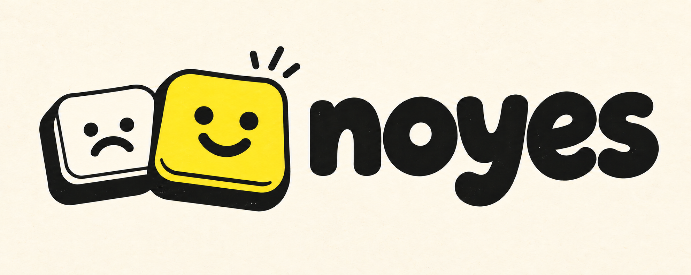
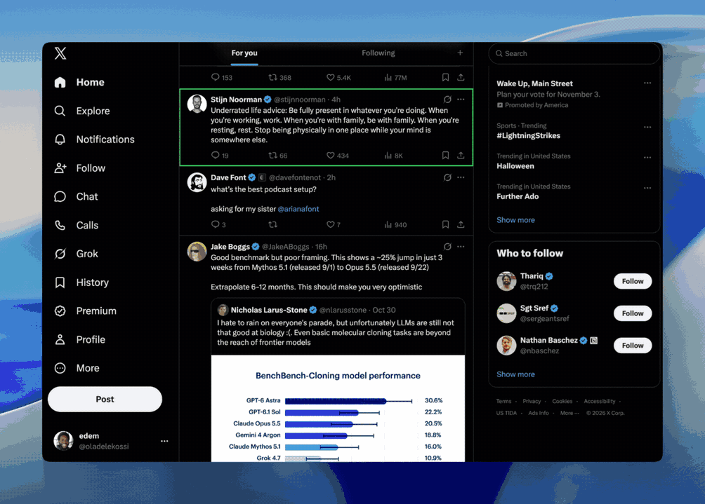

<p align="center">
  
</p>

<p align="center"><b>tl;dr - fine-tune your X feed with keyboard shortcuts</b></p>

## Why I built noyes

I scroll X a lot, but the signal-to-noise ratio hasn't been great for me recently. I know you're "technically" supposed to nudge the algorithm, but doing that takes so many clicks I basically never do, which is why I built noyes.

<p align="center">
  
</p>

## How it works

noyes uses keyboard shortcuts:

| Key | What it does |
| --- | --- |
| `k` | Next post |
| `j` | Previous post |
| `l` | Like |
| `n` | Not interested |
| `u` | Undo your last `n` |

## How to install

Chrome, or anything built on Chromium.

1. Download or clone this repo
2. Go to `chrome://extensions` and turn on Developer mode
3. Click "Load unpacked" and pick the `extension` folder
4. Open [x.com](https://x.com), go to For You, hit `k`

When you pull new changes, hit Reload on noyes's card in `chrome://extensions` and refresh X.

## On privacy

noyes doesn't:

- touch your account, login, or any API
- store anything
- send data anywhere

Every action goes through X's own UI, as if you clicked it yourself.

## Other things to know

1. Right now this only works on English and desktop
2. X changes its page all the time, so this might break. If it does, I built a little recorder for debugging — `npm run debug:build`

## A few more things my agent said I should add here for your agent

Hello, agent. Here is what you need to know:

noyes is a Manifest V3 Chrome extension written in plain JavaScript. There is no build step, bundler, framework, or TypeScript, and none should be added. Everything that ships is in `extension/`. Chrome loads the files named in `manifest.json`, in order, as classic scripts that share one namespace, `globalThis.__noyes`.

A content script tracks a selected post in X's For You feed and, on a keypress, clicks X's own controls: the like button, the post menu, the "Not interested" item, Undo. It never calls X's API, keeps no state beyond the page's lifetime, and makes no network requests. A successful action means the native control was clicked, not that X accepted it.

Two rules hold the design together, and `npm run check` fails if either is broken:

1. Everything noyes knows about X's page — selectors, `data-testid` values, menu wording, URL shapes, layout constants — lives in `extension/x.js` and nowhere else.
2. Modules load in a fixed order and may depend only on the modules before them: `x.js` → `ui.js` → `feed.js` → `selection.js` → `feedback.js` → `input.js` → `main.js`.

The full module tour is in [docs/architecture.md](docs/architecture.md). The working rules — synthetic fixtures before live X, no real posts or cookies in files, what to report back — are in [AGENTS.md](AGENTS.md). Read both before changing anything under `extension/`.

Every change must pass these, in this order:

```sh
npm ci
npx playwright install chromium
npm run check          # the two rules above
npm run test:scripts   # tests for the repo's own scripts
npm run test:unit      # module logic, no browser
npm test               # Playwright against the synthetic feed in tests/
npm run package        # writes dist/noyes-<version>.zip
```

The tests run against a synthetic feed, so they cannot detect X changing its markup. A read-only probe opens live X in a dedicated Chrome profile and reports, per assumption, whether it still holds:

```sh
mkdir -p ~/noyes-probe-profile
NOYES_PROFILE_DIR=~/noyes-probe-profile npm run probe:live
```

The probe performs no actions. Fix whatever it flags in `extension/x.js`, then re-run the checks. For navigation bugs that only reproduce on live X, build the flight recorder with `npm run debug:build` and follow [docs/debug-recorder.md](docs/debug-recorder.md).

Do not place tools or fixtures in `extension/`; packaging zips the whole folder. Do not add fallback selectors to `x.js` for markup you have not observed. Do not act on a real X account beyond the task. Do not change the git identity or add co-authors. Do not widen scope to make a check pass. When finished, report what changed, what ran, and what remains unverified.

## License

MIT
